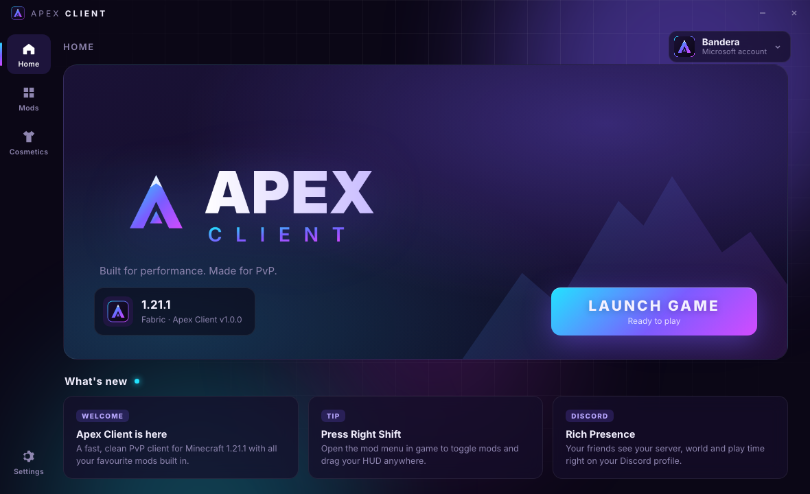

<p align="center"></p>

<p align="center">
  <b>A fast, clean Lunar-style client for Minecraft Java — every version from 1.8 to the latest</b><br>
  Own launcher · built-in PvP mods · draggable HUD · Discord Rich Presence · Windows 10 &amp; 11
</p>

<p align="center"></p>

## Download
Go to **[Releases](../../releases/latest)** and download **`ApexClient-Setup-x.x.x.exe`**.
Run it (if Windows says *"Windows protected your PC"* → **More info → Run anyway**), open **Apex Client**, press **LAUNCH GAME**.

- Sign in with your Microsoft account to play. You can also browse the launcher without signing in.
- Accounts without Minecraft can play the free **Demo**.
- Java, Minecraft, Fabric and Fabric API are downloaded automatically into `%APPDATA%\.apexclient`.

## Features

**Free for everyone: Luanti** — switch Home to **LUANTI · FREE** and press **PLAY FREE**. No Microsoft account or licence needed.
The launcher downloads the open-source [Luanti](https://www.luanti.org) engine and a Minecraft-like game
(**Mineclonia** or **VoxeLibre**) from their official sources, and lists public Luanti servers you can join in one click.

**Launcher**
- **Every Minecraft release from 1.8 to the newest** — pick it in the version box
  - **1.21.1** → full Apex Client (all mods below)
  - versions Fabric supports → Fabric + Fabric API + **Sodium** (FPS boost)
  - older versions → vanilla
  - each version has its own saves/mods folder; the right Java (8, 17 or 21) is downloaded automatically
- Microsoft login (remembered securely), Sign out / switch account, Demo support, browse without signing in
- **Mods & packs** — search Modrinth and install **mods, resource packs and shaders** in one click, per version;
  required dependencies install automatically, shaders set up Iris + Sodium, Installed tab with Remove
- **Servers page** — live status (players, MOTD, icon), add/remove servers, one-click **Play** joins directly; Quick join on Home
- **Screenshots gallery** for all versions
- **Stats** — play time, launches, last played
- **Launch options** — fullscreen, window size, Java arguments
- **Crash helper** — shows the log, explains common causes (memory, Java, mods, graphics driver), copy log
- **Repair game files** button, self-repairing Java install (checksum-verified)
- One-click install & launch with progress bar, bundled Java 21
- Mods / Cosmetics / Settings pages, RAM slider, game logs, news
- Discord Rich Presence ("In the launcher")
- Auto-updates the in-game mod from the latest GitHub release

**In game** — press **Right Shift**
| HUD | PvP / Visual | Other |
|---|---|---|
| FPS, CPS, Keystrokes | Zoom (hold **C**, scroll) | Apex Cape |
| Coordinates, Ping, Clock | Toggle Sprint | Custom main menu |
| Armor Status, Potion Effects, Server IP | Fullbright | Discord Rich Presence |

Every HUD element can be dragged in **Edit HUD Layout** (snaps to edges and center).

## Project layout
```
ApexClient/     In-game client (Fabric mod, Java 21, Gradle)
ApexLauncher/   Desktop launcher (Electron + minecraft-launcher-core + msmc)
.github/        GitHub Actions: builds the mod + Windows installer and publishes a release on every push
```

## How releases are built
Every push to `main` runs **Actions → Build Apex Client**:
1. builds `ApexClient.jar` (Linux runner)
2. builds `ApexClient-Setup-x.x.x.exe` with the jar inside (Windows runner)
3. publishes both as a new release

The launcher downloads the newest `ApexClient.jar` from the latest release on every launch, so players get mod updates without reinstalling.
For launcher updates, bump `version` in `ApexLauncher/package.json` and players download the new installer.

## Setup (owner)
1. **Discord Rich Presence** works out of the box (Application ID `1571423751231373405` in `ApexLauncher/config.js`).
   Images are loaded from `docs/discord/` in this repo, so nothing has to be uploaded to the Discord developer portal.
   Optional: put your server invite in `DISCORD_INVITE` to add a "Join our Discord" button.
2. **Repo name** — if your repo isn't `jakov543/ApexClient`, change `MOD_URL`, `DISCORD_IMAGES` and `DOWNLOAD_URL` in `ApexLauncher/config.js`
   and `publish` / `repository` in `ApexLauncher/package.json`.
3. **News** (optional) — set `NEWS_URL` in `config.js` to a raw `news.json`: `[{"tag":"UPDATE","t":"Title","p":"Text"}]`

## Tests
`cd ApexLauncher && npm test` — sign-in decisions, downloads (redirects, compressed, broken, web pages, checksums),
Luanti install, Modrinth installs, and UI wiring. GitHub runs them before every installer build.

## Build locally (optional)
Needs **Java 21 JDK** (https://adoptium.net) and **Node.js 20+** (https://nodejs.org).
Run **`BUILD-ALL.bat`** → installer in `ApexLauncher\dist\`. `TEST-LAUNCHER.bat` runs the launcher without packaging.

## Rebrand
- Names / folder / Discord: `ApexLauncher/config.js`, `productName` in `ApexLauncher/package.json`, `ApexClient.java`, `fabric.mod.json`
- Images: `ApexLauncher/renderer/assets/`, `ApexLauncher/build/icon.ico`, `ApexClient/src/main/resources/assets/apexclient/`
- Logo sources: `ApexClient/discord-assets/*.svg`

## License
MIT — see [LICENSE](LICENSE). Not affiliated with Mojang, Microsoft or the Luanti project. Minecraft is a trademark of Mojang AB.
Luanti (LGPL) and its games (GPL) are downloaded from their official sources at runtime and keep their own licences.
